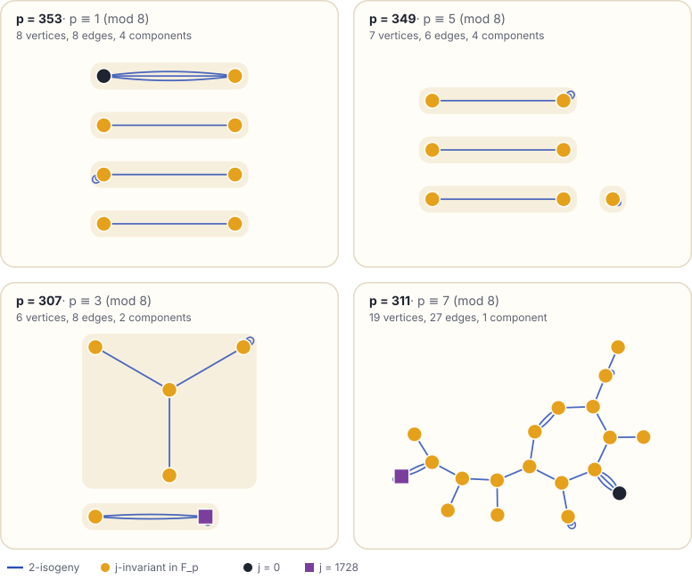
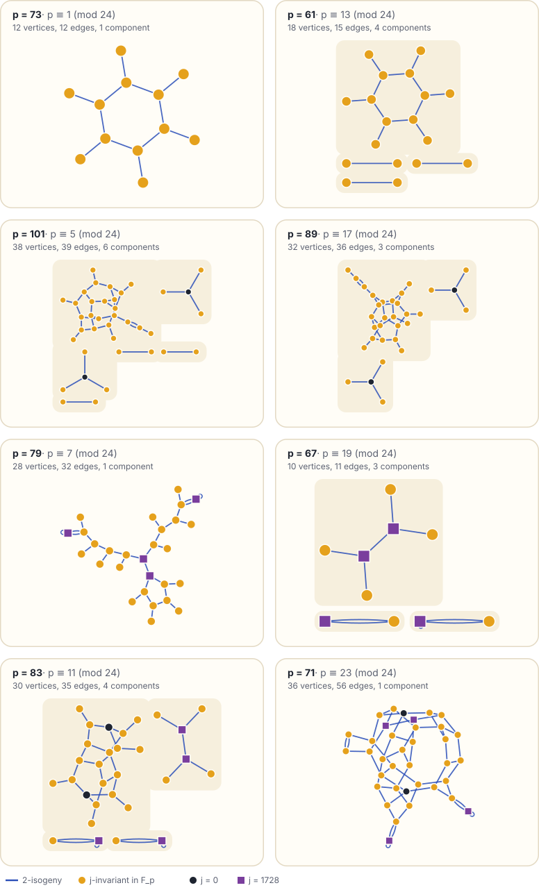
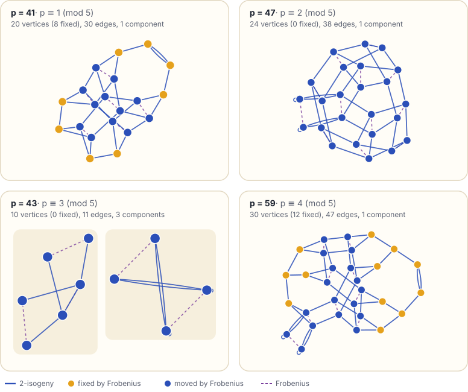

Definitions and proofs for the [animations](walks.qmd). The data is computed by `_scripts/isogeny_graphs.py`, with arithmetic in $\mathbb{F}_{p^2}$ (and $\mathbb{F}_{p^4}$ for points of order 5) and Vélu's formulas. A statement marked *checked* is verified by that script for every prime it computes.

## Conventions {#conventions}

- $p \geq 5$ is prime, and $\mathbb{F}_{p^2} = \mathbb{F}_p(\sqrt r)$ for a quadratic non-residue $r$ mod $p$. When $p \equiv 3 \pmod 4$, $r = -1$ and $\sqrt r$ is written $i$. Otherwise $-1$ is a square, and $r$ is the smallest positive non-residue; for example $r = 2$ for $p = 101$. Elements are written $a + b\sqrt r$ with $a, b \in \mathbb{F}_p$.
- $S$ is the set of supersingular $j$-invariants. They all lie in $\mathbb{F}_{p^2}$, and $\#S = \lfloor p/12 \rfloor + \{0, 1, 1, 2\}$ for $p \equiv 1, 5, 7, 11 \pmod{12}$.
- **Edges are directed and counted by kernels.** For a prime $\ell \neq p$, each of the $\ell + 1$ subgroups $K \subset E[\ell]$ of order $\ell$ gives an edge $E \to E/K$, so $A_{ij}$ is the number of $K \subset E_i$ with $E_i/K \cong E_j$.
- **Drawing.** Where $A_{ij} = A_{ji}$, the two vertices are joined by $A_{ij}$ plain edges, each standing for one isogeny in each direction. Where $A_{ij} \neq A_{ji}$, every isogeny is drawn as an arrow. An isogeny with $E/K \cong E$ is a loop. With level structure the label is $j(E)$.

## The graphs

### $G_p(2)$ {#graph-2}

The vertex set is $S$, and every vertex has 3 outgoing edges. Every eigenvalue other than 3 is an eigenvalue of $T_2$ on $S_2(\Gamma_0(p))$ (see [below](#spectral)), so $\lvert\lambda\rvert \le 2\sqrt2$, the Ramanujan bound (*checked*). For $p \equiv 1 \pmod{12}$ the graph is undirected and 3-regular, hence a Ramanujan graph in the usual sense (Pizer).

### $G_p(\{2,3\})$ and $G_p(\{2,3,5\})$ {#graph-23}

The same vertices, with adjacency $A_2 + A_3$, respectively $A_2 + A_3 + A_5$. The $A_\ell$ commute and are simultaneously diagonalisable, so the nontrivial eigenvalues are at most $\sum 2\sqrt\ell$ in absolute value (*checked*). All three graphs are offered for the same 221 primes from 101 to 49991. []{#graph-235}

### $\Gamma_0(5)$: $G_p(2)$ and $G_p(\{2,3\})$ {#graph-2b5}

A vertex is a pair $(E, C)$ with $C \subset E$ a subgroup of order 5, up to isomorphism. An isogeny $\varphi$ of degree 2 or 3 gives the edge $(E, C) \to (E/K, \varphi(C))$. The mass $\sum 1/\lvert\mathrm{Aut}(E, C)\rvert$ is $(p-1)/4$, six times the Eichler–Deuring mass $(p-1)/24$ (*checked*). Offered up to $p = 5000$. []{#graph-23b5}

### $\Gamma_1(5)$: $G_p(2)$ {#graph-2g15}

A vertex is a pair $(E, \pm P)$ with $P \in E$ a point of order 5, up to isomorphism. The script records $P$ by $x(P)$, which may lie in $\mathbb{F}_{p^4}$. A 2-isogeny $\varphi$ gives the edge $(E, \pm P) \to (E/K, \pm\varphi(P))$. No automorphism other than $\pm 1$ fixes $\pm P$ (at $j = 0$ and $j = 1728$ the extra automorphisms have no eigenvalue $\pm 1$ on $E[5]$), so there are $p - 1$ vertices and the mass is $(p-1)/2$ (*checked*). Offered up to $p = 5000$.

**This graph is directed.** The dual isogeny $\hat\varphi$ satisfies $\hat\varphi\varphi = [2]$, so it leads back to $\langle 2\rangle(E, \pm P) = (E, \pm 2P)$, where $\langle 2\rangle$ is the diamond operator. Since $2 \not\equiv \pm 1 \pmod 5$, this is a different vertex unless an automorphism of $E$ sends $P$ to $\pm 2P$. That happens only at $j = 1728$ (so only when $p \equiv 3 \pmod 4$), where the automorphism of order 4 acts on $E[5]$ with eigenvalues $\pm 2$: its two eigenlines give two vertices fixed by $\langle 2\rangle$. The Brandt relation becomes $A_{vw}\,\lvert\mathrm{Aut}\,w\rvert = A_{w,\langle 2\rangle v}\,\lvert\mathrm{Aut}\,v\rvert$ (*checked*).

### $\Gamma(2)$: $G_p(3)$ {#graph-3g2}

A vertex is a pair $(E, (P, Q))$ with $(P, Q)$ an ordered basis of $E[2]$, up to isomorphism. Write $e_1, e_2, e_3$ for the $x$-coordinates of $P, Q, P + Q$. The Legendre invariant $\lambda = (e_3 - e_1)/(e_2 - e_1)$ is a complete invariant, so the vertices are the supersingular $\lambda$: the roots of the Hasse polynomial $\sum_{k=0}^{m} \binom{m}{k}^2 \lambda^k$, $m = (p-1)/2$. There are $(p-1)/2$ of them, and the mass is $(p-1)/4$ (*checked*). A 3-isogeny $\varphi$ gives $(E, (P, Q)) \to (E/K, (\varphi P, \varphi Q))$. The dual returns $(3P, 3Q) = (P, Q)$, so $A$ satisfies the Brandt relation, and it is symmetric because every vertex has automorphism group $\pm 1$. Offered for $p \le 431$.

### $\Gamma(4)$: $G_p(3)$ and $G_p(5)$ {#graph-3g4}

[]{#graph-5g4}A vertex is $(E, (P, Q))$ with $(P, Q)$ an ordered basis of $E[4]$, up to isomorphism. The examples use the primes $p \equiv 3 \pmod 4$ from 11 to 103; for these all of $E[4]$ is defined over $\mathbb{F}_{p^2}$, on a model whose $p^2$-Frobenius is $[-p]$, because $4 \mid p + 1$.

- **Vertices.** For $N \ge 3$ an automorphism fixing a basis of $E[N]$ is the identity, so there are $\lvert\mathrm{GL}_2(\mathbb{Z}/4)\rvert \cdot (p-1)/24 = 4(p-1)$ vertices (*checked*). The dual of an $\ell$-isogeny returns $(\ell P, \ell Q)$, which is $(-P, -Q) \cong (P, Q)$ for $\ell = 3$ and $(P, Q)$ for $\ell = 5$, so both graphs are undirected (*checked*).
- **The Weil pairing.** $e_4(P, Q)$ is a primitive 4th root of unity, $\pm i$, and an $\ell$-isogeny $\varphi$ satisfies $e_4(\varphi P, \varphi Q) = e_4(P, Q)^{\ell}$. For $\ell = 3$ every edge joins the two classes: the graph is bipartite, with eigenvalue $-4$ (*checked*), and it is connected for the primes shown. For $\ell = 5$ no edge leaves a class: the graph is disconnected, with exactly two components, and the eigenvalue 6 appears twice (*checked*).
- **Frobenius swaps the classes**, since $e_4(\sigma P, \sigma Q) = e_4(P, Q)^p = e_4(P, Q)^{-1}$. So no vertex is fixed and the $\mathbb{F}_p$-subgraph is empty.

In general, with full level $N$, an $\ell$-isogeny multiplies the exponent of the Weil pairing by $\ell$, so the graph has at least as many components as $(\mathbb{Z}/N)^\times / \langle \ell \rangle$ has elements.

## Unbalanced edge counts {#directed}

Without level structure, $A_{ij}\,\lvert\mathrm{Aut}(E_j)\rvert = A_{ji}\,\lvert\mathrm{Aut}(E_i)\rvert$ (*checked*). So $A$ is symmetric except at $j = 0$ (supersingular when $p \equiv 2 \pmod 3$) and $j = 1728$ (when $p \equiv 3 \pmod 4$); for $p \equiv 1 \pmod{12}$ it is symmetric. With level structure the same holds with $\mathrm{Aut}(E, \alpha)$, the automorphisms preserving the level structure $\alpha$, and with the twist by $\langle 2\rangle$ on $\Gamma_1(5)$.

Example: in $G_p(2)$ at $p = 431$ there are 3 kernels from $j = 0$ to $j = 125$ and 1 back, and 2 from $j = 1728$ (written 4) to $j = 19$ and 1 back. The pictures draw these as 3 arrows and 1 arrow, and 2 arrows and 1 arrow. No prime is excluded and no edge is dropped. The eigenvalues, the edge counts on this page, the $\mathbb{F}_p$-subgraph and the quotient by Frobenius are all computed from the directed matrix $A$.

## The random walk {#walk}

On the full graphs the walker follows the **Petersson walk**. Without level structure, put $\langle E_i, E_j\rangle = w_i\,\delta_{ij}$ with $w_i = \lvert\mathrm{Aut}(E_i)\rvert/2$ on the free abelian group on $S$. The operator $T = \sum_{\ell \in L} T_\ell$ is self-adjoint for this pairing: $\langle TE_i, E_j\rangle = A_{ij}\,w_j = A_{ji}\,w_i$ (Kohel's thesis, Chapter 7, following Mestre and Oesterlé; see also Gross). The walk has
$$P_{ij} \;=\; \frac{\langle TE_i, E_j\rangle}{\sum_k \langle TE_i, E_k\rangle} \;=\; \frac{A_{ij}\,w_j}{s_i}, \qquad s_i = \sum_k A_{ik}\,w_k .$$

- $A_{ij}\,w_j$ is the number of isogenies $E_i \to E_j$ of the degrees in $L$, counted up to sign. So the walker picks an isogeny uniformly, where the simple random walk $P_0 = A/\sum_\ell(\ell+1)$ picks a kernel uniformly. The two have the same row at every vertex not joined to $j = 0$ or $j = 1728$.
- $(A_{ij}w_j)$ is symmetric, so $P$ is reversible with stationary vector proportional to $s_i = \sum_\ell(\ell+1) + 2A_{i,0} + A_{i,1728}$. The stationary vector of $P_0$ is proportional to $1/w_i$.
- At $p = 431$ in $G_p(2)$: from $j = 125$ the walker steps to $j = 0$ with probability $3/5$, and from $j = 1728$ it stays with probability $1/2$. The stationary weights are $5/3$ at $125$ and $4/3$ at $1728$ and at $19$, against $1$ elsewhere, $j = 0$ included. The page shows the stationary vector above the picture (*checked* against a numerical solution of $\pi P = \pi$ by `_tests/`).

**With level structure** a vertex is $v = (E, \alpha)$ and the same definition is used with $w_v = \lvert\mathrm{Aut}(E, \alpha)\rvert/2$. This is the Hermitian form of Codogni and Lido, for which $A^* = \langle \ell^{-1}\rangle A$ (their Prop. 2.2.2). The orders satisfy the mass formula $\sum_v 1/\lvert\mathrm{Aut}(v)\rvert = \tfrac{p-1}{24}\,[\mathrm{GL}_2(\mathbb{Z}/N) : H]$ (*checked*).

- $\Gamma_0(5)$: when $p \equiv 3 \pmod 4$, the two subgroups of order 5 at $j = 1728$ that are eigenlines of the automorphism of order 4 give vertices with $\lvert\mathrm{Aut}\rvert = 4$. Every other vertex has $\lvert\mathrm{Aut}\rvert = 2$ (*checked*). The walk is reversible.
- $\Gamma_1(5)$, $\Gamma(2)$, $\Gamma(4)$: all vertices have the same automorphism group ($\pm 1$, $\pm 1$, trivial), so the Petersson walk is the simple walk. On $\Gamma_1(5)$ it is not reversible, but its stationary vector is uniform, because every vertex also has 3 incoming edges.

On the other views (the $\mathbb{F}_p$-subgraph, the part over it, the quotient by Frobenius) there is no such form, and the walk is the simple random walk on the directed graph: each outgoing edge is equally likely.

## Frobenius {#frobenius}

Let $\sigma(x) = x^p$. For $E\colon y^2 = x^3 + ax + b$ put $E^{(p)}\colon y^2 = x^3 + a^p x + b^p$. The map $\pi_E\colon (x, y) \mapsto (x^p, y^p)$ is an isogeny $E \to E^{(p)}$ of degree $p$, and it carries subgroups and points of order prime to $p$ to subgroups and points of the same order. Applying $\sigma$ to the coefficients of Vélu's formulas gives $(E/K)^{(p)} \cong E^{(p)}/K^{(p)}$. So $\sigma$ acts on every graph above, on vertices and on edges, and it respects sources and targets (*checked*). On $j$-invariants, $\sigma(a + b\sqrt r) = a - b\sqrt r$.

**Order.** A supersingular curve has a model over $\mathbb{F}_{p^2}$ on which $\pi^2 = [-p]$, so $\sigma^2$ acts on torsion points as multiplication by $-p$. It therefore fixes every curve and every subgroup, every basis of $E[2]$, and every basis of $E[4]$ when $p \equiv 3 \pmod 4$: $\sigma^2 = 1$ on the graphs without level structure and with $\Gamma_0(5)$, $\Gamma(2)$ or $\Gamma(4)$ structure. On $\Gamma_1(5)$, $\sigma^2(E, \pm P) = (E, \pm pP)$, so $\sigma^2 = \langle p \rangle$. That is the identity when $p \equiv \pm 1 \pmod 5$ and $\langle 2\rangle$ when $p \equiv \pm 2 \pmod 5$. In the second case $\sigma$ has order 4, and its orbits have size 4, except that when $p \equiv 3 \pmod 4$ the two vertices fixed by $\langle 2\rangle$ form one orbit of size 2 (verified on the data for $p = 307, 827, 2503, 4507$).

**Fixed edges.** Let $j(E) \in \mathbb{F}_p$ with $j \neq 0, 1728$, and take a model over $\mathbb{F}_p$. Then $\sigma$ acts on the edges out of $E$ by $K \mapsto \pi(K)$, with $\pi$ the Frobenius endomorphism. So an edge is fixed exactly when $K$ is defined over $\mathbb{F}_p$, i.e. when it is an $\mathbb{F}_p$-rational isogeny. (A twist replaces $\pi$ by $-\pi$, which has the same effect on subgroups.)

## The $\mathbb{F}_p$-subgraph {#spine}

**Definition.** The $\mathbb{F}_p$-subgraph, also called the spine, is the subgraph induced on the vertices fixed by Frobenius. That is, it consists of those vertices and every edge, with multiplicity, whose source and target are both fixed. Frobenius acts on the level structure as well, so with level structure a vertex is fixed when $(E^{(p)}, C^{(p)}) \cong (E, C)$ (similarly for $\pm P$ and for a basis of $E[2]$), not merely when $j(E) \in \mathbb{F}_p$.

1. Frobenius fixes this vertex set pointwise, so it permutes the edges of the $\mathbb{F}_p$-subgraph. The fixed edges are the $\mathbb{F}_p$-rational isogenies; the others are moved. The $\mathbb{F}_p$-subgraph keeps both kinds. For $G_p(2)$ at $p = 431$, 41 of its 49 directed edges are fixed by Frobenius.
2. Without level structure, the vertex set is the set of vertices fixed by Frobenius. It has $\tfrac12 h(-4p)$, $h(-p)$ or $2h(-p)$ elements for $p \equiv 1 \pmod 4$, $7 \pmod 8$, $3 \pmod 8$ (Delfs–Galbraith; *checked*), so it is never empty.
3. With level structure it is smaller than the set of vertices with $j(E) \in \mathbb{F}_p$: at $p = 431$, the $\Gamma_0(5)$ graph has 120 vertices with $j(E) \in \mathbb{F}_p$, of which 42 are fixed. It can be empty; see [below](#fixed-level).
4. On the animations page the random walk is switched off when the $\mathbb{F}_p$-subgraph is not connected.

Some examples, one prime per residue class. Each panel gives the numbers of vertices, edges and components; blue, red and green edges are 2-, 3- and 5-isogenies.

### An alternative display for level structure {#over}

For a graph with level structure, forgetting the level structure maps it onto $G_p(\ell)$. The **part over the $\mathbb{F}_p$-subgraph** is the subgraph induced on the vertices $(E, \cdot)$ with $j(E) \in \mathbb{F}_p$, that is, on the preimage of the $\mathbb{F}_p$-subgraph of $G_p(\ell)$. Frobenius maps it to itself. Its fixed vertices (gold) span the $\mathbb{F}_p$-subgraph of the level-structure graph; the other vertices (blue) are joined to their Frobenius images by dashed lines. On the animations page this is the fourth option of the view menu, offered for the graphs with level structure.

Below, one prime per residue class. The header of each panel counts the components of the subgraph itself; the shaded boxes group pieces that Frobenius joins. As the [proposition below](#fixed-level) predicts, there are no gold vertices for $\Gamma_0(5)$ when $p \equiv \pm 2 \pmod 5$, for $\Gamma_1(5)$ unless $p \equiv 4 \pmod 5$, and for $\Gamma(2)$ when $p \equiv 1 \pmod 4$.

## The quotient by Frobenius {#folded}

**Definition.** The vertices of the quotient are the orbits of Frobenius on vertices, and its directed edges are the orbits of Frobenius on directed edges, running from the orbit of the source to the orbit of the target.

When Frobenius is an involution, the quotient has $(n + f_V)/2$ vertices and $(\lvert E\rvert + f_E)/2$ directed edges, where $f_V$ and $f_E$ count the fixed vertices and fixed directed edges. A fixed vertex $v$ with $f_v$ fixed outgoing edges has $(\deg v + f_v)/2$ outgoing edges in the quotient. For example, a vertex of $G_p(2)$ with $j \in \mathbb{F}_p$ and $p \equiv 1 \pmod 4$ has one fixed outgoing edge (Delfs–Galbraith), so 2 outgoing edges in the quotient.

## Blooming {#ball}

Both animations grow a ball from a vertex $v$ by breadth-first search, following arrows forwards.

- **Blooming for collision** searches the graph shown. It stops at the first edge that reaches a vertex already in the ball, other than along the tree edge it came in by, and draws the shortest cycle found in that layer; loops (length 1) and parallel edges (length 2) count. Where edges are arrows, in particular on $\Gamma_1(5)$, the search stops when two shortest paths from $v$ meet, which is a cycle only once directions are ignored.
- **Blooming for conjugates** searches the full graph, even when the picture shows the quotient. It stops once the ball contains two vertices $w \neq \sigma w$ of one Frobenius orbit. On the quotient the ball is the image of the ball upstairs, and it stops when a vertex is reached by a second lift (the same condition) or when a vertex fixed by Frobenius is reached. Why this pair is of interest is explained on the [Blooming](balls.qmd) page.
- On the disconnected $\Gamma(4)$ graph a ball can fill its component without stopping, since Frobenius swaps the components.

## Until the $\mathbb{F}_p$-subgraph {#until}

The **until** menu replaces each animation's stopping rule by: stop at the first vertex fixed by Frobenius. The walk starts at a uniformly random vertex outside the $\mathbb{F}_p$-subgraph, and the page shows the number of steps and the mean over the walks run so far. That mean is an empirical estimate of the hitting time, not a computed expectation. A ball grows from a vertex outside the $\mathbb{F}_p$-subgraph; its final radius is the distance from the centre to the $\mathbb{F}_p$-subgraph.

## The spectral law {#spectral}

For $\ell \neq p$ the adjacency matrix of $G_p(\ell)$ is the Brandt matrix $B(\ell)$. It has the eigenvalue $\ell + 1$, and its other $n - 1$ eigenvalues are those of the Hecke operator $T_\ell$ on $S_2(\Gamma_0(p))$, a space of dimension $n - 1$, the genus of $X_0(p)$ (Eichler; see Gross). They lie in $[-2\sqrt\ell, 2\sqrt\ell]$ (*checked*).

**Theorem (Serre, 1997).** Fix a prime $\ell$. As $p \to \infty$, the eigenvalues of $T_\ell$ on $S_2(\Gamma_0(p))$ become equidistributed with respect to the Kesten–McKay law
$$\mu_\ell = \frac{\ell+1}{2\pi}\,\frac{\sqrt{4\ell - x^2}}{(\ell+1)^2 - x^2}\,dx \quad\text{on } [-2\sqrt\ell, 2\sqrt\ell],$$
the spectral measure of the $(\ell+1)$-regular tree (Kesten, McKay).

The animation shows a 60-bin histogram of the eigenvalues for 129 primes from 101 to 49991, with the density of $\mu_\ell$ in red, and the Kolmogorov distance $\sup_x \lvert F_p(x) - F_\ell(x)\rvert$ between the empirical distribution function and that of $\mu_\ell$. For $\ell = 2$ the distance is 0.125 at $p = 101$, 0.006 at $p = 20011$ and 0.004 at $p = 49991$; for $\ell = 3$ it is 0.197, 0.007 and 0.005; for $\ell = 5$ it is 0.232, 0.007 and 0.006. The data is in `assets/data/isogeny/spectra.json`.

### Sums of Hecke operators {#joint}

The operators $T_2, T_3, T_5$ commute and are self-adjoint for the Petersson inner product, so $S_2(\Gamma_0(p))$ has a basis of simultaneous eigenvectors, each with a triple $(\lambda_2, \lambda_3, \lambda_5)$. The eigenvalues of $G_p(L)$ other than $\sum_{\ell\in L}(\ell+1)$ are the sums $\sum_{\ell \in L} \lambda_\ell$ over that basis.

Serre's theorem holds for finitely many primes at once (Serre, 1997): as $p \to \infty$ the tuples $(\lambda_\ell)_{\ell \in L}$ become equidistributed for the product measure $\bigotimes_{\ell\in L} \mu_\ell$. The limit of the spectrum of $G_p(L)$ is therefore the push-forward of the product under $s(x) = \sum_\ell x_\ell$,
$$s_*\Big(\bigotimes_{\ell \in L} \mu_\ell\Big) = \mathop{\ast}_{\ell\in L}\, \mu_\ell ,$$
the convolution of the Kesten–McKay laws, supported on $\big[-\sum_\ell 2\sqrt\ell,\ \sum_\ell 2\sqrt\ell\big]$.

The second moment of $\mu_\ell$ is $\ell + 1$ (the number of closed walks of length 2 at a vertex of the tree) and $\mu_\ell$ is symmetric, so the convolution has second moment $\sum_\ell (\ell+1)$: $7$ for $\{2,3\}$ and $13$ for $\{2,3,5\}$. At $p = 49991$ the eigenvalues give $7.001$ and $13.003$, the pairwise correlations of $\lambda_2, \lambda_3, \lambda_5$ are below $0.001$ in absolute value, and the Kolmogorov distances to the convolutions are about $0.005$ (the numbers are in `spectra.json`).

## Limit laws {#limits}

The pictures on the [Limit laws](limits.qmd) page. Their data is computed by `_scripts/limit_laws.py` with PARI/GP, and a statement marked *checked* is verified by that script on all of its data. Throughout, eigenvalues are rescaled to $[-2, 2]$: for $T_\ell$ in weight $k$, $x = \lambda/\ell^{(k-1)/2}$, so $x = \lambda/\sqrt\ell$ in weight 2. On $[-2, 2]$ the Sato–Tate law and the rescaled Kesten–McKay law are
$$\mu_{\mathrm{ST}} = \frac{\sqrt{4 - x^2}}{2\pi}\,dx, \qquad \mu_\ell = \frac{\ell(\ell+1)}{(\ell+1)^2 - \ell x^2}\,\mu_{\mathrm{ST}} ,$$
the image of the law in [the spectral law](#spectral) under $x \mapsto x/\sqrt\ell$. With the Chebyshev polynomials $X_m(2\cos\theta) = \sin((m+1)\theta)/\sin\theta$, Serre (1997) characterises $\mu_\ell$ by
$$\int X_m \, d\mu_\ell = \begin{cases} \ell^{-m/2} & m \text{ even},\\ 0 & m \text{ odd},\end{cases} \qquad \int X_m \, d\mu_{\mathrm{ST}} = \begin{cases} 1 & m = 0,\\ 0 & m \geq 1.\end{cases}$$
These are the facts used below; the $X_m$ span the polynomials, and all the measures involved live on $[-2, 2]$, so convergence of every $\int X_m$ is weak convergence.

### Kesten–McKay to Sato–Tate {#kmst}

**Proposition.** As $\ell \to \infty$, $\mu_\ell \to \mu_{\mathrm{ST}}$ in total variation, and
$$d_{\mathrm{TV}}(\mu_\ell, \mu_{\mathrm{ST}}) = \frac{3\sqrt3}{4\pi\ell} + O(\ell^{-2}), \qquad \sup_x \lvert F_\ell(x) - F_{\mathrm{ST}}(x)\rvert = \frac{3\sqrt3}{8\pi\ell} + O(\ell^{-2}),$$
where $d_{\mathrm{TV}} = \tfrac12 \int \lvert f_\ell - f_{\mathrm{ST}}\rvert$ and $F$ denotes a distribution function.

*Proof.* On $[-2, 2]$ the denominator $(\ell+1)^2 - \ell x^2$ is at least $(\ell - 1)^2$, and
$$\frac{\ell(\ell+1)}{(\ell+1)^2 - \ell x^2} = 1 + \frac{x^2 - 1}{\ell} + O(\ell^{-2})$$
uniformly in $x$. So $f_\ell - f_{\mathrm{ST}} = f_{\mathrm{ST}}(x)(x^2 - 1)/\ell + O(\ell^{-2})$. With $x = 2\cos\theta$, and $\sin^2\theta\,(1 + 2\cos 2\theta) = \tfrac12(\cos 2\theta - \cos 4\theta)$, whose primitive $\tfrac14\sin 2\theta - \tfrac18 \sin 4\theta$ takes the values $0, \tfrac{3\sqrt3}{16}, -\tfrac{3\sqrt3}{16}, 0$ at $\theta = 0, \pi/3, 2\pi/3, \pi$,
$$\int_{-2}^{2} f_{\mathrm{ST}}(x)\,\lvert x^2 - 1\rvert\,dx = \frac{2}{\pi}\int_0^\pi \sin^2\theta\,\lvert 1 + 2\cos 2\theta\rvert\,d\theta = \frac{2}{\pi}\cdot\frac{3\sqrt3}{4} = \frac{3\sqrt3}{2\pi},$$
which gives $d_{\mathrm{TV}}$. For the distribution functions, $G(x) = \int_{-2}^x f_{\mathrm{ST}}(t)(t^2-1)\,dt$ vanishes at $\pm 2$, increases on $[-2,-1]$ and $[1,2]$ and decreases on $[-1,1]$; so $\sup \lvert G\rvert = G(-1) = -G(1)$, which is half the positive part of the integral above, $3\sqrt3/(8\pi)$. $\square$

The picture shows $\mu_\ell$ for the 169 primes $\ell \leq 1009$, with the two distances computed numerically. At $\ell = 101$ they are $0.004081$ and $0.002040$, against $3\sqrt3/(4\pi\ell) = 0.004094$ and $3\sqrt3/(8\pi\ell) = 0.002047$; at $\ell = 1009$ both agree with the first-order terms to the six decimals shown, $0.000410$ and $0.000205$ (*tested* in `_tests/limits.test.mjs`). The same picture is the "ℓ → ∞" entry of [the spectral law](spectral.qmd).

### Hecke operators with a character {#star}

[]{#quadratic}Let $N$ be prime and $\chi$ a Dirichlet character mod $N$. The space $S_2(N, \chi)$ of weight-2 cusp forms for $\Gamma_0(N)$ with character $\chi$ is $0$ unless $\chi(-1) = 1$, and
$$S_2(\Gamma_1(N)) = \bigoplus_{\chi \text{ even}} S_2(N, \chi).$$
For $\ell \nmid N$ the adjoint of $T_\ell$ for the Petersson product is $\langle\ell\rangle^{-1} T_\ell$ (Diamond–Shurman, Chapter 5), which is $\overline{\chi(\ell)}\, T_\ell$ on $S_2(N,\chi)$. So every eigenvalue satisfies $\bar\lambda = \overline{\chi(\ell)}\,\lambda$, that is $\lambda = \chi(\ell)\bar\lambda$ (*checked*), and $\lambda$ lies on the line $\omega\mathbb{R}$ for either square root $\omega$ of $\chi(\ell)$: the line through 0 at angle $\arg\chi(\ell)/2$.

**$S_2(\Gamma_1(101))$.** The even characters mod 101 are the characters of $(\mathbb{Z}/101)^\times/\{\pm1\}$, a cyclic group of order 50 generated by the image of 2 (2 is a primitive root mod 101). So $\chi(2)$ runs over all 50th roots of unity, one character each, and the 376 eigenvalues of $T_2$ (the genus of $X_1(101)$, *checked*) lie on 50 distinct lines. The lines at angles $\theta$ and $\pi - \theta$ carry complex-conjugate spectra, since $\bar\chi$ has the conjugate eigenvalues (*checked*).

**Theorem (Serre, 1997, Théorème 4).** Fix a prime $\ell$. Let $N + k \to \infty$ with $\ell \nmid N$, and let $\chi$ be a character mod $N$ with $\chi(-1) = (-1)^k$. Then the eigenvalues of $\chi(\ell)^{-1/2}\ell^{-(k-1)/2}T_\ell$ on $S_k(N, \chi)$ become equidistributed for $\mu_\ell$.

Serre states this extension of his theorem to the full spaces $S_k(N,\chi)$ without details, by the same method; Ross (2025) recalls it and treats the newspaces $S_k^{\mathrm{new}}(N,\chi)$. For prime $N$ every form in $S_2(N,\chi)$ is new, as $S_2(\mathrm{SL}_2(\mathbb{Z})) = 0$. The choice of square root does not matter, since $\mu_\ell$ is symmetric. So the character changes the line on which the eigenvalues lie, and after rotation it leaves no trace in the limit; the picture shows all 376 rotated eigenvalues against $\mu_2$.

**The quadratic family.** For a prime $N \equiv 5 \pmod 8$ the Legendre symbol $\chi = (\cdot/N)$ is even, as $N \equiv 1 \pmod 4$, and $\chi(2) = (2/N) = -1$. So the eigenvalues of $T_2$ on $S_2(N, \chi)$ are purely imaginary (*checked*), and by the theorem $\lambda/(i\sqrt2)$ is distributed according to $\mu_2$ as $N \to \infty$. The spectrum is symmetric under $\lambda \mapsto -\lambda$ (*checked*): $\chi$ is real, so $f \mapsto \overline{f(-\bar z)}$ preserves $S_2(N,\chi)$ and sends an eigenform with eigenvalue $\lambda$ to one with eigenvalue $\bar\lambda = -\lambda$. The picture uses 20 primes from 101 to 3701.

### The planar limit {#planar}

Without rotating, the eigenvalues of $T_\ell$ on all of $S_2(\Gamma_1(N))$ are points of the plane. The statement below is not taken from the sources on this page; the proof is a sketch.

**Proposition.** Fix a prime $\ell$. For primes $N \to \infty$, let $\nu_N$ be the uniform probability measure on the eigenvalues of $\ell^{-1/2} T_\ell$ on $S_2(\Gamma_1(N))$, counted with multiplicity, a measure on the disc $\lvert z\rvert \leq 2$. Then $\nu_N$ converges weakly to the rotation-invariant measure $\nu$ on the disc for which $\lvert z \rvert$ is distributed as $\lvert X\rvert$ with $X \sim \mu_\ell$: in polar coordinates, $d\nu = 2 f_\ell(r)\,dr\,\tfrac{d\theta}{2\pi}$ for $0 \leq r \leq 2$.

*Proof sketch.* Write $d_\chi = \dim S_2(N, \chi)$ and $D = \sum_\chi d_\chi$, the genus of $X_1(N)$. By the dimension formula (Cohen–Oesterlé), $d_\chi = N/12 + O(1)$ uniformly in the even $\chi$.

1. *Each character, uniformly.* Let $\omega_\chi^2 = \chi(\ell)$ and $x_f = \omega_\chi^{-1}\lambda_f/\sqrt\ell$, a real number. The Hecke relations give $X_m(\omega^{-1}\ell^{-1/2}T_\ell) = \omega^{-m}\ell^{-m/2}T_{\ell^m}$ on $S_2(N,\chi)$. In the Eichler–Selberg trace formula for $T_{\ell^m}$ on $S_2(N, \chi)$ the identity term is $\chi(\ell^{m/2})(N+1)/12$ for $m$ even and $0$ for $m$ odd. Once $N^2 > 4\ell^m$, every other term involves $\chi$ only through a bounded number of its values (in the elliptic terms, at the at most two roots mod $N$ of $x^2 - tx + \ell^m$), each of absolute value 1, and is bounded independently of $N$ and $\chi$. As $\omega^{-m}\chi(\ell^{m/2}) = 1$ for even $m$,
$$\frac{1}{d_\chi}\sum_f X_m(x_f) = \int X_m\,d\mu_\ell + O_{\ell, m}(1/N) \quad\text{uniformly in } \chi ,$$
and so $\frac{1}{d_\chi}\sum_f x_f^m = M_m + O_{\ell,m}(1/N)$ with $M_m = \int x^m\,d\mu_\ell$. This is Serre's argument with the error term kept uniform in $\chi$.
2. *Averaging over the characters.* Let $z_f = \omega_\chi x_f$, so $\bar z_f = \omega_\chi^{-1} x_f$. For $a, b \geq 0$ and $m = a + b$,
$$\int z^a\bar z^b\,d\nu_N = \sum_\chi \frac{d_\chi}{D}\,\omega_\chi^{a-b}\big(M_m + O(1/N)\big).$$
If $m$ is odd, $M_m = 0$. If $m$ is even, so is $a - b = 2j$, and $\omega_\chi^{a-b} = \chi(\ell^j)$. Now $\sum_{\chi \text{ even}} \chi(\ell^j)$ is $(N-1)/2$ if $\ell^j \equiv \pm 1 \pmod N$ and $0$ otherwise; for $j \neq 0$ and $N > \ell^{\lvert j\rvert} + 1$ it is $0$, so with $d_\chi = N/12 + O(1)$ the sum is $O(N)$ against $D \asymp N^2/24$. Hence $\int z^a \bar z^b\,d\nu_N \to \delta_{ab} M_{2a}$.
3. *The limit.* $\int z^a \bar z^b\,d\nu = \int r^{a+b} e^{i(a-b)\theta}\,d\nu = \delta_{ab}\,\mathbb{E}\lvert X\rvert^{2a} = \delta_{ab} M_{2a}$. All the measures live on the disc of radius 2 (Eichler–Shimura and Weil), and polynomials in $z$ and $\bar z$ are dense in its continuous functions (Stone–Weierstrass), so $\nu_N \to \nu$. $\square$

For $\ell = 2$, $M_2 = 3/2$. The number of lines is the order of $\ell$ in $(\mathbb{Z}/N)^\times/\{\pm1\}$, which tends to infinity with $N$ but not monotonically: 50 lines for $N = 101$, 9 for $N = 73$. The picture shows 14 primes $N$ from 29 to 251. At $N = 251$ (2501 eigenvalues on 25 lines, as 2 has order 50 mod 251) the mean of $\lvert z\rvert^2$ is $1.476$, the absolute value of the mean of $z^2$ is $0.023$ (limit 0), and the Kolmogorov distance between the law of $\lvert z\rvert$ and that of $\lvert X\rvert$ is $0.017$.

### The diagonal limit {#diagonal}

In the [spectral law](#spectral) $\ell$ is fixed and the limit is $\mu_\ell$; letting $\ell \to \infty$ afterwards gives $\mu_{\mathrm{ST}}$ ([above](#kmst)). The two limits can also be taken together. As for the planar limit, this statement is not taken from the sources below, and the proof is a sketch.

**Proposition.** Let $p \to \infty$ through the primes, and let $\ell = \ell(p) \neq p$ be primes with $\ell \to \infty$ and $\log \ell / \log p \to 0$. Then the eigenvalues of $\ell^{-1/2}T_\ell$ on $S_2(\Gamma_0(p))$ become equidistributed for $\mu_{\mathrm{ST}}$.

*Proof sketch.* As above, $\sum_f X_m(\lambda_f/\sqrt\ell) = \ell^{-m/2}\,\mathrm{Tr}\,T_{\ell^m}$. In the Eichler–Selberg formula for $n = \ell^m$ on $S_2(\Gamma_0(p))$ the identity term is $(p+1)/12$ for $m$ even. Once $p^2 > 4n$, $p$ divides none of the conductors $f$ in the elliptic terms, which are then bounded by $\sum_{t^2 < 4n} H(4n - t^2) \leq 2\sigma(n)$ (the Kronecker–Hurwitz class number relation); the hyperbolic and Eisenstein terms are at most $2\sigma(n)$ and $\sigma(n)$. All of this is $O(\ell^m)$. Dividing by $\dim S_2(\Gamma_0(p)) = p/12 + O(1)$,
$$\frac{1}{\dim}\sum_f X_m(\lambda_f/\sqrt\ell) = \begin{cases}\ell^{-m/2}\big(1 + O(1/p)\big) & m\text{ even}\\ 0 & m \text{ odd}\end{cases} \;+\; O\Big(\frac{\ell^{m/2}}{p}\Big).$$
For fixed $m \geq 1$ both terms tend to 0, because $\ell \to \infty$ and $\ell^{m/2}/p = p^{\,m\log\ell/(2\log p) - 1} \to 0$. $\square$

Murty and Sinha (2009) work out explicit bounds for each term of the trace formula. The picture takes $\ell$ to be the largest prime $\leq (\log p)^2$, which satisfies the hypothesis, for 28 primes $p$ from 101 to 20011 (so $\ell$ from 19 to 97), and computes the eigenvalues from the Brandt matrix $B(\ell)$, the adjacency matrix of $G_p(\ell)$: $B(\ell)_{ij}$ is the multiplicity of $j_j$ as a root of $\Phi_\ell(j_i, Y)$ over $\mathbb{F}_{p^2}$. The script checks that the rows of $B(\ell)$ sum to $\ell + 1$, that $B(\ell)\,\mathrm{diag}(\lvert\mathrm{Aut}(E_j)\rvert)$ is symmetric, that $B(\ell)$ commutes with $B(2)$, and the Ramanujan bound. At $p = 20011$, $\ell = 97$, the Kolmogorov distance to $\mu_{\mathrm{ST}}$ is $0.017$ (to $\mu_{97}$: $0.016$); at that size $\mu_{97}$ and $\mu_{\mathrm{ST}}$ differ by about $3\sqrt3/(8\pi\cdot 97) = 0.002$, less than the distance of either to the data.

### The weight aspect {#weight}

**Theorem (Conrey–Duke–Farmer, 1997; Serre, 1997).** Fix a prime $\ell$. As $k \to \infty$ through the even integers, the eigenvalues of $\ell^{-(k-1)/2}T_\ell$ on $S_k(\mathrm{SL}_2(\mathbb{Z}))$ become equidistributed for $\mu_\ell$.

The picture uses $k = 24, 48, \dots, 960$, where $\dim S_k = k/12$, and $\ell = 2, 3, 5$. The matrix of $T_\ell$ is computed exactly on the basis $\Delta^i E_4^a E_6^b$ ($1 \leq i \leq \dim S_k$, $4a + 6b = k - 12i$) from $q$-expansions, and its characteristic polynomial is solved numerically with enough digits; the script checks it against PARI's `mfheckemat` for $k \leq 120$, and that $T_2 \Delta = -24\Delta$. All the rescaled eigenvalues lie in $[-2, 2]$ (Deligne; *checked*). With at most 80 eigenvalues the histograms are coarse: at $k = 960$ the Kolmogorov distance to $\mu_2$ is $0.044$.

## When the $\mathbb{F}_p$-subgraph is empty {#fixed-level}

Without level structure the $\mathbb{F}_p$-subgraph is never empty. With level structure it can be, for the following reason.

**Lemma.** Suppose a vertex $(E, \mathcal{L})$ is fixed by Frobenius, where $\mathcal{L}$ is the level structure. Then $j(E) \in \mathbb{F}_p$, and there is a twist $E'$ of $E$ over $\mathbb{F}_p$ whose Frobenius endomorphism $\pi'$ preserves $\mathcal{L}$ and satisfies $\pi'^2 = -p$.

*Proof.*

1. Being fixed gives $j(E) \in \mathbb{F}_p$. Take a model over $\mathbb{F}_p$, with Frobenius $\pi$; being fixed means $\xi\pi$ preserves $\mathcal{L}$ for some $\xi \in \mathrm{Aut}(E)$.
2. $\pi' = \xi\pi$ is the Frobenius of a twist $E'$ of $E$ over $\mathbb{F}_p$, and $E'$ is supersingular. So its trace $t$ is divisible by $p$, and the Hasse bound $\lvert t\rvert \le 2\sqrt p < p$ forces $t = 0$, hence $\pi'^2 = -p$. $\square$

**Proposition.**

- **$\Gamma_0(N)$, $N$ an odd prime.** If $-p$ is not a square mod $N$, the $\mathbb{F}_p$-subgraph is empty. For $N = 5$: whenever $p \equiv \pm 2 \pmod 5$.
- **$\Gamma_1(5)$.** If $p \not\equiv 4 \pmod 5$, it is empty.
- **$\Gamma(2)$.** If $p \equiv 1 \pmod 4$, it is empty.

*Proof.* In each case, use the $\pi'$ of the lemma.

- **$\Gamma_0(N)$.** $\pi'$ acts on the cyclic group $C$ of order $N$ by some $\lambda \in \mathbb{F}_N$, and $\lambda^2 = -p$.
- **$\Gamma_1(5)$.** $\pi'(P) = \pm P$, so $(\pm1)^2 = -p$ in $\mathbb{F}_5$, i.e. $p \equiv 4 \pmod 5$.
- **$\Gamma(2)$.** $\pi'$ fixes $E[2]$ pointwise, so $\pi' - 1$ kills $E[2]$ and $\alpha = (\pi' - 1)/2$ is an endomorphism. Since $\pi'^2 = -p$, $\alpha$ satisfies $\alpha^2 + \alpha + (1 + p)/4 = 0$, which has integer coefficients only if $p \equiv 3 \pmod 4$. $\square$

The converses are only observed: among the primes in the menu, the $\mathbb{F}_p$-subgraph is nonempty for every $p \equiv \pm1 \pmod 5$ ($\Gamma_0(5)$), every $p \equiv 4 \pmod 5$ ($\Gamma_1(5)$: $p = 599, 1009, 1499, 1999, 2999, 4999$) and every $p \equiv 3 \pmod 4$ ($\Gamma(2)$: $p = 211, 307, 431$). When the subgraph is empty, the page says why and offers the nearest prime where it is not.

## Numbers at $p = 431$

Computed by the script. Edges are directed. "Spine" means the $\mathbb{F}_p$-subgraph (the vertices fixed by Frobenius, and the edges between them); "fixed edges" are the edges fixed by Frobenius, which all lie in the spine; the last two columns describe the quotient by Frobenius.

| graph | vertices | spine vertices | edges | spine edges | fixed edges | quotient vertices | quotient edges |
|---|--:|--:|--:|--:|--:|--:|--:|
| $G_p(2)$ | 37 | 21 | 111 | 49 | 41 | 29 | 76 |
| $G_p(\{2,3\})$ | 37 | 21 | 259 | 107 | 83 | 29 | 171 |
| $G_p(\{2,3,5\})$ | 37 | 21 | 481 | 187 | 125 | 29 | 303 |
| $G_p(2)$, $\Gamma_0(5)$ | 216 | 42 | 648 | 88 | 84 | 129 | 366 |
| $G_p(\{2,3\})$, $\Gamma_0(5)$ | 216 | 42 | 1512 | 176 | 168 | 129 | 840 |
| $G_p(2)$, $\Gamma_1(5)$ | 430 | 0 | 1290 | 0 | 0 | 215 | 645 |
| $G_p(3)$, $\Gamma(2)$ | 215 | 63 | 860 | 138 | 126 | 139 | 493 |

## Numbers at $p = 431$

Computed by the script. Edges are directed. "Spine" means the $\mathbb{F}_p$-subgraph (the vertices fixed by Frobenius, and the edges between them); "fixed edges" are the edges fixed by Frobenius, which all lie in the spine; the last two columns describe the quotient by Frobenius.

| graph | vertices | spine vertices | edges | spine edges | fixed edges | quotient vertices | quotient edges |
|---|--:|--:|--:|--:|--:|--:|--:|
| $G_p(2)$ | 37 | 21 | 111 | 49 | 41 | 29 | 76 |
| $G_p(\{2,3\})$ | 37 | 21 | 259 | 107 | 83 | 29 | 171 |
| $G_p(\{2,3,5\})$ | 37 | 21 | 481 | 187 | 125 | 29 | 303 |
| $G_p(2)$, $\Gamma_0(5)$ | 216 | 42 | 648 | 88 | 84 | 129 | 366 |
| $G_p(\{2,3\})$, $\Gamma_0(5)$ | 216 | 42 | 1512 | 176 | 168 | 129 | 840 |
| $G_p(2)$, $\Gamma_1(5)$ | 430 | 0 | 1290 | 0 | 0 | 215 | 645 |
| $G_p(3)$, $\Gamma(2)$ | 215 | 63 | 860 | 138 | 126 | 139 | 493 |

## Sources

- Christina Delfs and Steven Galbraith, [Computing isogenies between supersingular elliptic curves over F_p](https://arxiv.org/abs/1310.7789): the count of $j$-invariants in $\mathbb{F}_p$, and the rational 2-isogenies.
- Taha Hedayat, Sarah Arpin and Renate Scheidler, [The spine of a supersingular ℓ-isogeny graph](https://arxiv.org/abs/2502.03613): the spine, as the subgraph induced on the $\mathbb{F}_p$-vertices.
- Arnold Pizer, *Ramanujan graphs and Hecke operators*, Bull. AMS 23 (1990).
- Benedict Gross, *Heights and the special values of L-series*, CMS Conf. Proc. 7 (1987): Brandt matrices and $T_\ell$.
- David Kohel, [Endomorphism rings of elliptic curves over finite fields](https://www.i2m.univ-amu.fr/perso/david.kohel/pub/thesis.pdf), PhD thesis, Berkeley (1996), Chapter 7: the pairing $\langle E_i, E_j\rangle = w_i\,\delta_{ij}$ on the supersingular curves, for which $T_\ell$ is self-adjoint.
- Giulio Codogni and Guido Lido, [Spectral theory of isogeny graphs](https://arxiv.org/abs/2308.13913), J. Number Theory 286 (2026): level structures $H \subset \mathrm{GL}_2(\mathbb{Z}/N)$, the Hermitian form weighted by $\lvert\mathrm{Aut}(E, \varphi)\rvert$, and $A^* = \langle \ell^{-1}\rangle A$.
- Jean-Pierre Serre, *Répartition asymptotique des valeurs propres de l'opérateur de Hecke $T_p$*, J. AMS 10 (1997): the Kesten–McKay limit, its Chebyshev moments, and (Théorème 4) the extension to characters.
- Erick Ross, [Hecke eigenvalue equidistribution over the newspaces with nebentypus](https://arxiv.org/abs/2511.13966), arXiv:2511.13966 (2025): recalls Serre's Théorème 4 and treats the newspaces $S_k^{\mathrm{new}}(N,\chi)$.
- J. Brian Conrey, William Duke and David Farmer, [The distribution of the eigenvalues of Hecke operators](https://arxiv.org/abs/math/9609214), Acta Arith. 78 (1997): the weight aspect in level one.
- M. Ram Murty and Kaneenika Sinha, *Effective equidistribution of eigenvalues of Hecke operators*, J. Number Theory 129 (2009): explicit bounds for the terms of the Eichler–Selberg trace formula.
- Fred Diamond and Jerry Shurman, *A First Course in Modular Forms*, GTM 228: $S_k(\Gamma_1(N)) = \bigoplus_\chi S_k(N,\chi)$ and the adjoints of the Hecke operators (Chapter 5).
- Henri Cohen and Joseph Oesterlé, *Dimensions des espaces de formes modulaires*, Lecture Notes in Math. 627 (1977): the dimension of $S_k(N,\chi)$.
- Harry Kesten, *Symmetric random walks on groups*, Trans. AMS 92 (1959); Brendan McKay, *The expected eigenvalue distribution of a large regular graph*, Linear Algebra Appl. 40 (1981).
- Joseph Silverman, *The Arithmetic of Elliptic Curves*: the Hasse bound (Ch. V) and twists (Ch. X).
