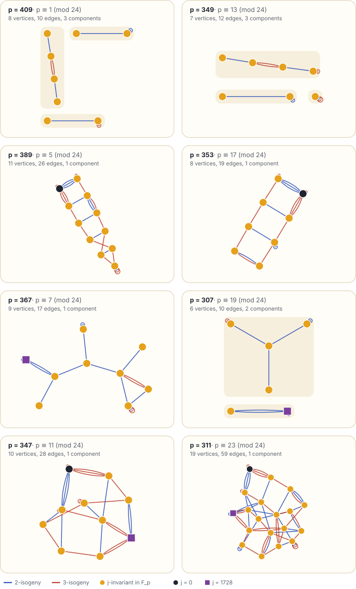
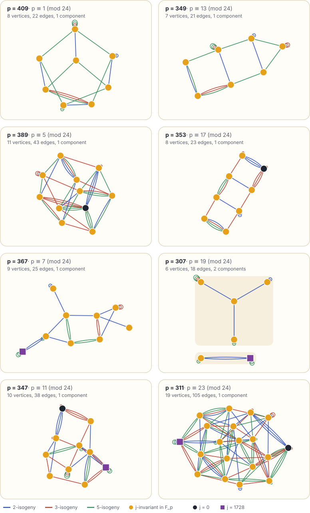
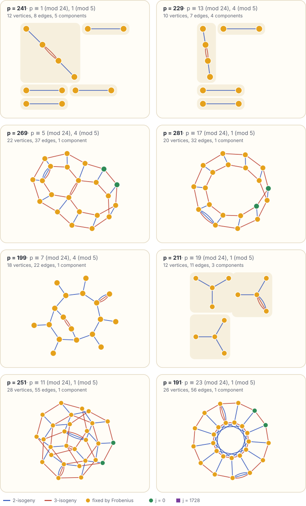

This page states exactly what the [animations](walks.qmd) draw. Everything is computed from scratch by `_scripts/isogeny_graphs.py`, using arithmetic in $\mathbb{F}_{p^2}$ (and $\mathbb{F}_{p^4}$ for points of order 5) and Vélu's formulas. The script checks the facts marked *checked* for every prime it computes.

## Conventions {#conventions}

- $p \geq 5$ is prime, and $\mathbb{F}_{p^2} = \mathbb{F}_p(i)$ with $i^2 = r$ a quadratic non-residue ($r = -1$ when $p \equiv 3 \pmod 4$). Each $j$-invariant is written $a + bi$ with $a, b \in \mathbb{F}_p$.
- $S$ is the set of supersingular $j$-invariants. They all lie in $\mathbb{F}_{p^2}$, and $\#S = \lfloor p/12 \rfloor + \{0, 1, 1, 2\}$ for $p \equiv 1, 5, 7, 11 \pmod{12}$.
- **Edges are directed and counted by kernels.** For a prime $\ell \neq p$, each of the $\ell + 1$ subgroups $K \subset E[\ell]$ of order $\ell$ gives an edge $E \to E/K$. Without level structure, the adjacency matrix $A$ satisfies $A_{ij}\,\lvert\mathrm{Aut}(E_j)\rvert = A_{ji}\,\lvert\mathrm{Aut}(E_i)\rvert$ (*checked*), so it is symmetric away from $j = 0, 1728$.
- **Drawing.** Between two vertices of an undirected graph, $\max(A_{ij}, A_{ji})$ edges are drawn as parallel arcs, and $E/K \cong E$ is drawn as a loop. Vertices are labelled by $j$-invariants (with level structure, by $j(E)$).

## The graphs

### $G_p(2)$ {#graph-2}

The vertex set is $S$, and every vertex has 3 outgoing edges. Apart from the trivial eigenvalue 3, every eigenvalue satisfies $\lvert\lambda\rvert \le 2\sqrt2$ (Pizer, via Deligne): this is a Ramanujan graph. The page shows the second-largest $\lvert\lambda\rvert$ (*checked* against the bound). It is offered up to $p = 20011$.

### $G_p(\{2,3\})$ and $G_p(\{2,3,5\})$ {#graph-23}

The same vertices, with adjacency $A_2 + A_3$, respectively $A_2 + A_3 + A_5$. Every vertex has $3 + 4$, respectively $3 + 4 + 6$, outgoing edges. The $A_\ell$ commute, so the nontrivial eigenvalues are at most $\sum 2\sqrt\ell$ in absolute value (*checked*). The 5-isogenies use the kernel polynomial $x^2 - sx + q$ of each subgroup of order 5; for them the script checks that the target is supersingular and that the Brandt symmetry holds. Both graphs are offered up to $p = 20011$. []{#graph-235}

### Level structure $\Gamma_0(5)$: $G_p(2)$ and $G_p(\{2,3\})$ {#graph-2b5}

A vertex is a pair $(E, C)$ with $C \subset E$ a subgroup of order 5, up to isomorphism. An isogeny $\varphi$ of degree 2 or 3, which is prime to 5, gives the edge $(E, C) \to (E/K, \varphi(C))$. The mass $\sum 1/\lvert\mathrm{Aut}(E, C)\rvert$ is $(p-1)/4$, six times the Eichler–Deuring mass $(p-1)/24$ of $S$ (*checked*). These graphs are offered up to $p = 5000$. []{#graph-23b5}

### Level structure $\Gamma_1(5)$: $G_p(2)$ {#graph-2g15}

A vertex is a pair $(E, \pm P)$ with $P \in E$ a point of order 5, up to isomorphism. Here $\pm$ is there because $-1$ is an automorphism of every curve. The point $P$ is recorded by $x(P)$, which may lie in $\mathbb{F}_{p^4}$ rather than $\mathbb{F}_{p^2}$. Isomorphisms act by $(a, b, x) \mapsto (u^4 a, u^6 b, u^2 x)$, so $(a/x(P)^2,\ b/x(P)^3)$ is a complete invariant. A 2-isogeny $\varphi$ gives the edge $(E, \pm P) \to (E/K, \pm\varphi(P))$. The mass is $(p-1)/2$ (*checked*), and there are $p - 1$ vertices for the primes shown.

**This graph is directed.** The dual isogeny $\hat\varphi$ satisfies $\hat\varphi\varphi = [2]$, so it sends $\pm\varphi(P)$ to $\pm 2P$, and $(E, \pm 2P) \neq (E, \pm P)$ because $2 \not\equiv \pm1 \pmod 5$. The Brandt symmetry becomes $A_{vw}\,\lvert\mathrm{Aut}\,w\rvert = A_{w,\langle 2\rangle v}\,\lvert\mathrm{Aut}\,v\rvert$, where the diamond operator $\langle 2\rangle$ sends $(E, \pm P)$ to $(E, \pm 2P)$ (*checked*). The random walk follows the directions of the edges. Offered up to $p = 5000$.

### Full level structure $\Gamma(2)$: $G_p(3)$ {#graph-3g2}

A small example of full level structure. A vertex is a pair $(E, (P, Q))$ with $(P, Q)$ an ordered basis of $E[2]$, up to isomorphism. Write $e_1, e_2, e_3$ for the $x$-coordinates of $P, Q, P + Q$. Then the Legendre invariant $\lambda = (e_3 - e_1)/(e_2 - e_1)$ is a complete invariant, so the vertices are the supersingular $\lambda$: the roots of the Hasse polynomial $\sum_{i=0}^{m} \binom{m}{i}^2 \lambda^i$, $m = (p-1)/2$. There are exactly $(p-1)/2$ of them (*checked*). A 3-isogeny $\varphi$ gives $(E, (P, Q)) \to (E/K, (\varphi P, \varphi Q))$. Since $3 \equiv 1 \pmod 2$, the dual returns the same basis, so this graph is undirected. The mass is $(p-1)/4$ (*checked*). Offered for $p \le 431$.

## Frobenius {#frobenius}

Let $\sigma(x) = x^p$. For $E\colon y^2 = x^3 + ax + b$ put $E^{(p)}\colon y^2 = x^3 + a^p x + b^p$. The map $\pi_E\colon (x, y) \mapsto (x^p, y^p)$ is an isogeny $E \to E^{(p)}$ of degree $p$, and it carries subgroups and points of order prime to $p$ to subgroups and points of the same order. Applying $\sigma$ to the coefficients of Vélu's formulas gives $(E/K)^{(p)} \cong E^{(p)}/K^{(p)}$. So $\sigma$ acts on every graph above, on vertices ($E \mapsto E^{(p)}$, carrying the level structure along) and on edges, and it respects sources and targets (*checked*).

On $j$-invariants, $\sigma(a + bi) = a - bi$. **$\sigma^2$ is the identity, except on $\Gamma_1(5)$.** A supersingular curve has a model over $\mathbb{F}_{p^2}$ on which $\pi^2 = [-p]$, so $\sigma^2(E, \pm P) = (E, \pm pP) = \langle p\rangle(E, \pm P)$. That is the identity when $p \equiv \pm 1 \pmod 5$, and $\langle 2\rangle$ when $p \equiv \pm 2 \pmod 5$, in which case Frobenius has orbits of size 4 (*checked*). Subgroups ($\Gamma_0$) and bases of $E[2]$ ($\Gamma(2)$, since $p$ is odd) are not affected.

**Fixed edges.** Let $j(E) \in \mathbb{F}_p$ with $j \neq 0, 1728$, and take a model over $\mathbb{F}_p$. Then $\sigma$ acts on the edges out of $E$ by $K \mapsto \pi(K)$, with $\pi$ the Frobenius endomorphism. So an edge is fixed exactly when $K$ is defined over $\mathbb{F}_p$, i.e. when it is an $\mathbb{F}_p$-rational isogeny. (A twist replaces $\pi$ by $-\pi$, which has the same effect on subgroups.)

## The $\mathbb{F}_p$-subgraph {#spine}

**Definition.** The $\mathbb{F}_p$-subgraph, also called the spine, is the subgraph induced on the vertices whose $j$-invariant lies in $\mathbb{F}_p$ (with level structure, $j(E) \in \mathbb{F}_p$). That is, it consists of those vertices and every edge, with multiplicity, whose source and target are both among them.

1. Frobenius preserves this vertex set, so it permutes the edges of the $\mathbb{F}_p$-subgraph. The fixed edges are the $\mathbb{F}_p$-rational isogenies; the others are moved. The $\mathbb{F}_p$-subgraph keeps both kinds. For $G_p(2)$ at $p = 431$, 41 of its 49 directed edges are fixed by Frobenius.
2. Without level structure, the vertex set is the set of vertices fixed by Frobenius. It has $\tfrac12 h(-4p)$, $h(-p)$ or $2h(-p)$ elements for $p \equiv 1 \pmod 4$, $7 \pmod 8$, $3 \pmod 8$ (Delfs–Galbraith; *checked*), so it is never empty.
3. With level structure it also contains vertices that Frobenius moves. At $p = 431$ the $\Gamma_0(5)$ version has 120 vertices, of which 42 are fixed.
4. On the animations page the random walk is switched off when the $\mathbb{F}_p$-subgraph is not connected.

Some examples, one prime per residue class. Each panel gives the numbers of vertices, edges and components; blue, red and green edges are 2-, 3- and 5-isogenies.

## The quotient by Frobenius {#folded}

**Definition.** The vertices of the quotient are the orbits of Frobenius on vertices, and its directed edges are the orbits of Frobenius on directed edges, running from the orbit of the source to the orbit of the target. This is well defined because Frobenius respects sources and targets.

The edge orbits need Frobenius on edges, not just on vertices, so the script computes them and the page only draws them. When Frobenius is an involution, the quotient has $(n + f_V)/2$ vertices and $(\lvert E\rvert + f_E)/2$ directed edges, where $f_V$ and $f_E$ count the fixed vertices and fixed directed edges. A fixed vertex $v$ with $f_v$ fixed outgoing edges has $(\deg v + f_v)/2$ outgoing edges in the quotient. For example, a vertex of $G_p(2)$ with $j \in \mathbb{F}_p$ and $p \equiv 1 \pmod 4$ has one fixed outgoing edge (Delfs–Galbraith), so 2 outgoing edges in the quotient.

## Growing balls {#ball}

The [growing-ball animation](balls.qmd) runs a breadth-first search from a random vertex $v$ in the full graph, one layer at a time.

- **On the full graph** it stops once the ball contains two vertices of one Frobenius orbit, for instance $w$ and $w^{(p)} \neq w$. Since $\sigma$ preserves distances, $w, \sigma w \in B_r(v)$ exactly when $w \in B_r(v) \cap B_r(\sigma v)$. Joining the two shortest paths gives a path from $E$ to $E^{(p)}$ of length at most $2r$, and composing it with Frobenius gives an endomorphism of $E$.
- **On the quotient by Frobenius** the ball is the image of the ball upstairs, and it remembers which lift it reached each vertex by. It stops at the first self-collision, when a vertex is reached again by a different lift (the condition above), or when it reaches the $\mathbb{F}_p$-subgraph, whichever comes first.

## The spectral law {#spectral}

For $\ell \neq p$ the adjacency matrix of $G_p(\ell)$ is the Brandt matrix $B(\ell)$. It has the eigenvalue $\ell + 1$ (the Eisenstein series), and its other $n - 1$ eigenvalues are those of the Hecke operator $T_\ell$ on $S_2(\Gamma_0(p))$, a space of dimension $n - 1$, the genus of $X_0(p)$ (Eichler; see Gross). They lie in $[-2\sqrt\ell, 2\sqrt\ell]$ (*checked*).

**Theorem (Serre, 1997).** Fix a prime $\ell$. As $p \to \infty$, the eigenvalues of $T_\ell$ on $S_2(\Gamma_0(p))$ become equidistributed with respect to the Kesten–McKay law
$$\mu_\ell = \frac{\ell+1}{2\pi}\,\frac{\sqrt{4\ell - x^2}}{(\ell+1)^2 - x^2}\,dx \quad\text{on } [-2\sqrt\ell, 2\sqrt\ell],$$
the spectral measure of the $(\ell+1)$-regular tree (Kesten, McKay).

The animation shows the histogram of the eigenvalues for 21 primes from 101 to 20369, with the density of $\mu_\ell$ in red. The inset tracks the Kolmogorov distance $\sup_x \lvert F_p(x) - F_\ell(x)\rvert$ between the empirical distribution function and that of $\mu_\ell$. For $\ell = 2$ it falls from 0.125 at $p = 101$ to 0.005 at $p = 20369$; for $\ell = 3$ from 0.197 to 0.008; for $\ell = 5$ from 0.232 to 0.008. These eigenvalues are stored in `assets/data/isogeny/spectra.json`.

## Frobenius-fixed $\Gamma_0(N)$-structures {#fixed-level}

**Proposition.** Let $N$ be an odd prime. If $-p$ is not a square modulo $N$, then no pair $(E, C)$ with $C$ of order $N$ is fixed by Frobenius. For $N = 5$: there is none when $p \equiv \pm 2 \pmod 5$.

*Proof.*

1. Suppose $(E^{(p)}, C^{(p)}) \cong (E, C)$. Then $j(E) \in \mathbb{F}_p$; take a model over $\mathbb{F}_p$, with Frobenius endomorphism $\pi$. Being fixed means $\xi(\pi(C)) = C$ for some $\xi \in \mathrm{Aut}(E)$.
2. The endomorphism $\pi' = \xi\pi$ is the Frobenius of a twist of $E$ over $\mathbb{F}_p$. That twist is supersingular, so its trace $t$ is divisible by $p$; the Hasse bound gives $\lvert t\rvert \le 2\sqrt p < p$, so $t = 0$ and $\pi'^2 = -p$.
3. $\pi'$ acts on the cyclic group $C$ by some $\lambda \in \mathbb{F}_N$, and $\pi'^2 = -p$ gives $\lambda^2 = -p$ in $\mathbb{F}_N$. $\square$

The converse is only observed, for the primes computed.

## Numbers at $p = 431$

Computed by the script. "Spine" means the $\mathbb{F}_p$-subgraph; edges are directed; "fixed" means fixed by Frobenius; the last column counts the edges of the quotient.

| graph | vertices | spine vertices | fixed vertices | quotient vertices | edges | spine edges | fixed edges | quotient edges |
|---|--:|--:|--:|--:|--:|--:|--:|--:|
| $G_p(2)$ | 37 | 21 | 21 | 29 | 111 | 49 | 41 | 76 |
| $G_p(\{2,3\})$ | 37 | 21 | 21 | 29 | 259 | 107 | 83 | 171 |
| $G_p(\{2,3,5\})$ | 37 | 21 | 21 | 29 | 481 | 187 | 125 | 303 |
| $G_p(2)$, $\Gamma_0(5)$ | 216 | 120 | 42 | 129 | 648 | 276 | 84 | 366 |
| $G_p(\{2,3\})$, $\Gamma_0(5)$ | 216 | 120 | 42 | 129 | 1512 | 600 | 168 | 840 |
| $G_p(2)$, $\Gamma_1(5)$ | 430 | 238 | 0 | 215 | 1290 | 546 | 0 | 645 |
| $G_p(3)$, $\Gamma(2)$ | 215 | 119 | 63 | 139 | 860 | 320 | 126 | 493 |

## What the script checks

For every prime it computes, the script stops with an error unless all of the following hold:

- The number of supersingular $j$-invariants, and of those in $\mathbb{F}_p$, agrees with the class number formulas.
- Every Vélu quotient is a root of $\Phi_2$ or $\Phi_3$, and every 5-isogeny lands on a supersingular curve.
- The Brandt symmetry holds (twisted by $\langle 2\rangle$ for $\Gamma_1(5)$).
- The masses are $(p-1)/4$ ($\Gamma_0(5)$), $(p-1)/2$ ($\Gamma_1(5)$) and $(p-1)/4$ ($\Gamma(2)$), and $\Gamma(2)$ has $(p-1)/2$ vertices.
- Frobenius is an automorphism on vertices and edges, of order 2, except that on $\Gamma_1(5)$ its square is $\langle p\rangle$.
- The second-largest eigenvalue is within the Ramanujan bound, and every eigenvalue of $T_\ell$ on $S_2(\Gamma_0(p))$ lies in $[-2\sqrt\ell, 2\sqrt\ell]$.

## Sources

- Christina Delfs and Steven Galbraith, [Computing isogenies between supersingular elliptic curves over F_p](https://arxiv.org/abs/1310.7789): the count of $j$-invariants in $\mathbb{F}_p$, and the rational 2-isogenies.
- Taha Hedayat, Sarah Arpin and Renate Scheidler, [The spine of a supersingular ℓ-isogeny graph](https://arxiv.org/abs/2502.03613): the spine, as the subgraph induced on the $\mathbb{F}_p$-vertices.
- Arnold Pizer, *Ramanujan graphs and Hecke operators*, Bull. AMS 23 (1990).
- Benedict Gross, *Heights and the special values of L-series*, CMS Conf. Proc. 7 (1987): Brandt matrices and $T_\ell$.
- Jean-Pierre Serre, *Répartition asymptotique des valeurs propres de l'opérateur de Hecke $T_p$*, J. AMS 10 (1997).
- Harry Kesten, *Symmetric random walks on groups*, Trans. AMS 92 (1959); Brendan McKay, *The expected eigenvalue distribution of a large regular graph*, Linear Algebra Appl. 40 (1981).
- Joseph Silverman, *The Arithmetic of Elliptic Curves*: the Hasse bound (Ch. V) and twists (Ch. X).
