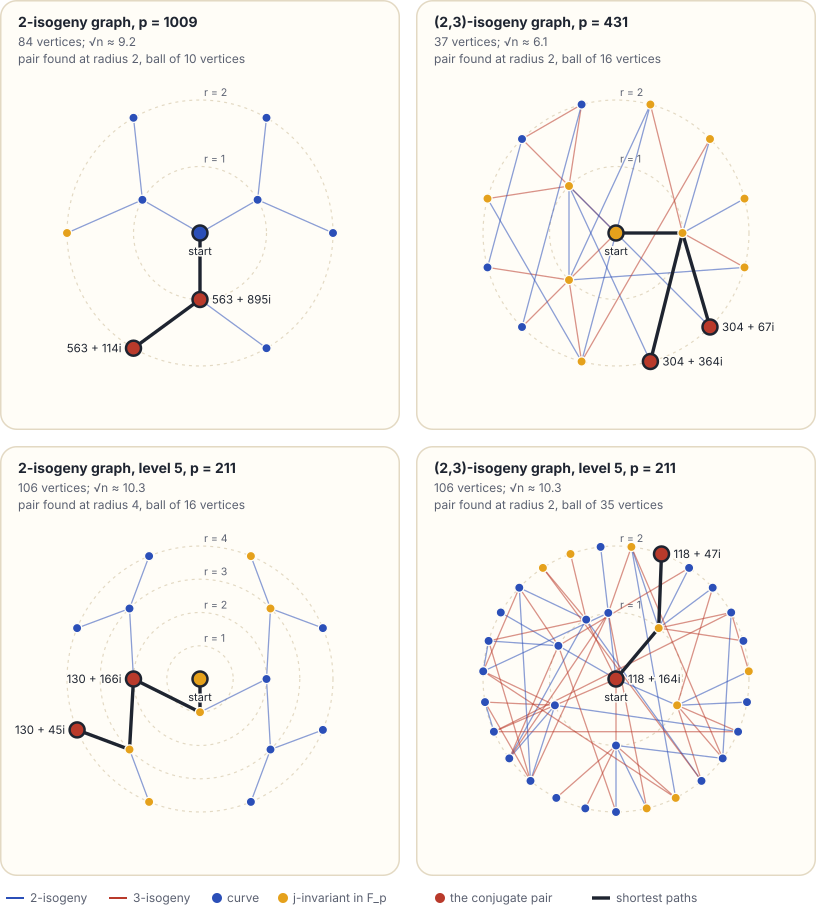

<!-- The description of each animation is in the box at the top of the picture. Its text
     is in _partials/isogeny-widget.qmd, one block per animation, and it changes when the
     animation menu changes. -->

::: {data-mode="ball"}

:::

```{=html}
<script type="module" src="../assets/js/isogeny-hero.js"></script>
```

## Why the conjugate pair is worth finding

Frobenius $\sigma\colon E \mapsto E^{(p)}$ is an automorphism of the graph, so it preserves distances. Hence $w$ and $\sigma(w)$ both lie in $B_r(v)$ exactly when $w$ lies in $B_r(v) \cap B_r(\sigma(v))$. Write $E$ for the curve at $v$. The conjugate of a shortest path from $v$ to $\sigma(w)$ runs from $\sigma(v)$ to $w$; following the path from $v$ to $w$ and then that conjugate path backwards gives a path from $E$ to $E^{(p)}$ of length at most $2r$. Composing it with the Frobenius isogeny $E^{(p)} \to E^{(p^2)} \cong E$ gives an endomorphism of $E$.

So the ball stops growing when $B_r(v)$ and $B_r(\sigma(v))$ first meet off the $\mathbb{F}_p$-subgraph, as in a meet-in-the-middle search. Heuristically (birthday paradox, treating the balls as random subsets) this happens once the balls have on the order of $\sqrt{n}$ vertices, where $n$ is the number of vertices.

## Four examples

Each picture is one ball, drawn by layer: the start in the middle, the vertices at distance $r$ on the $r$-th circle, and the edges between vertices of the ball (loops and repeated edges are not shown). Vertices fixed by Frobenius are gold. The examples are on the full graph.

{fig-alt="Four panels. Each shows a ball drawn in concentric layers around a starting vertex, with the conjugate pair in red and the shortest paths to it in black. The pair appears at radius 2 in three examples and at radius 4 in the third."}

## How big the ball gets

For each graph and each prime, the ball is grown from every vertex in turn. The chart shows the mean size of the ball when it first contains a conjugate pair. It stays between $0.8\sqrt{n}$ and $3.1\sqrt{n}$ for the primes here (up to $p = 20011$ without level structure, $p = 4999$ with), which is consistent with the heuristic above. Hover a point for its numbers.



The figures are made by `_scripts/ball_diagrams.py` from the same data as the animation.
