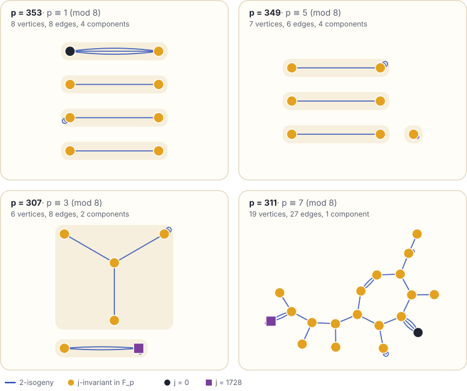
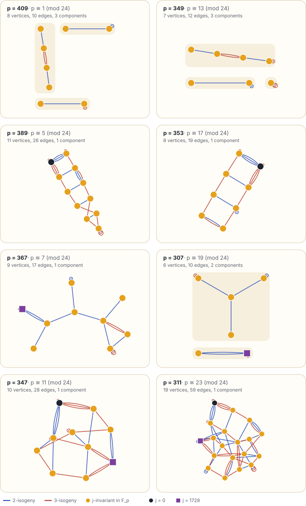
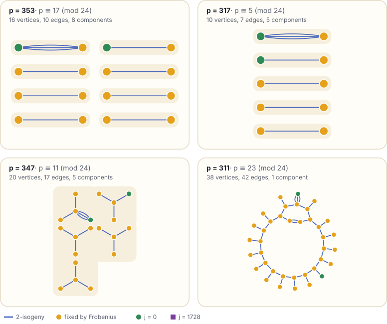
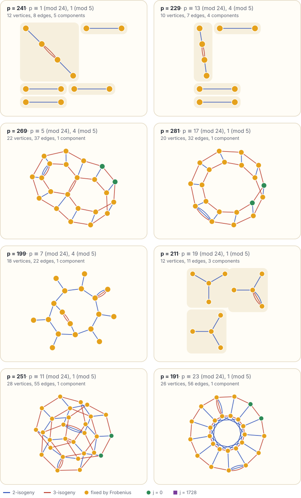

The [random walk](walks.qmd) graph has three views. The **spine** view keeps only the vertices fixed by Frobenius, that is, the curves defined over $\mathbb{F}_p$ (for level structure: the pairs $(E, C)$ fixed by $(E, C)\mapsto(E^{(p)}, C^{(p)})$), and the edges between them. The **folded** view is the quotient of the whole graph by Frobenius: each conjugate pair becomes one vertex, and an edge is an orbit of edges.

The pictures below are the spines for one prime in each residue class. They were computed with `_scripts/isogeny_graphs.py` and drawn by `_scripts/spine_diagrams.py` (the arithmetic is done from scratch in $\mathbb{F}_{p^2}$ with Vélu's formulas, and every graph passes the consistency checks listed at the top of the first script). Blue edges are 2-isogenies, red edges are 3-isogenies, a loop is an isogeny from a vertex to itself, and several edges between two vertices are drawn as parallel arcs. These are observations from the primes shown, not proofs.

## The 2-isogeny graph, by $p \bmod 8$

{fig-alt="Four panels. For p equal to 1 or 5 mod 8 the spine is a set of disjoint edges (with one isolated vertex when p is 5 mod 8). For p equal to 3 mod 8 it is a claw plus an edge. For p equal to 7 mod 8 it is one connected graph with a cycle and pendant vertices."}

For $p \equiv 1 \pmod 4$ each $\mathbb{F}_p$-curve has a single outgoing $\mathbb{F}_p$-rational 2-isogeny, so the spine falls apart into pairs (Delfs–Galbraith make this point for $p = 101$). For $p \equiv 3 \pmod 8$ the examples are a claw plus a pair; for $p \equiv 7 \pmod 8$ the spine is connected.

## The (2,3)-isogeny graph, by $p \bmod 24$

{fig-alt="Eight panels, one for each unit class of p mod 24. Classes 1, 13 and 19 give a few small pieces (paths, edges, a claw); classes 5, 11, 17 and 23 give connected graphs with many cycles; class 7 gives a connected graph with few cycles."}

In these examples the spine is connected for $p \equiv 5, 7, 11, 17, 23 \pmod{24}$ and has two or three components for $p \equiv 1, 13, 19 \pmod{24}$.

## The 2-isogeny graph with level-3 structure

{fig-alt="Four panels. For p equal to 5 or 17 mod 24 the spine is a set of disjoint edges; for p equal to 11 mod 24 it is a few small trees; for p equal to 23 mod 24 it is one large cycle with pendant vertices."}

For all 31 primes between 300 and 700 with $p \equiv 1 \pmod 3$, the level-3 spine is empty: no pair $(E, C)$ is fixed by Frobenius (and it is nonempty for every prime there with $p \equiv 2 \pmod 3$). For $p \equiv 23 \pmod{24}$ it is a single long cycle with pendant vertices.

## The (2,3)-isogeny graph with level-5 structure

{fig-alt="Eight panels. Small primes give disjoint edges, claws and short paths; larger classes give connected graphs with large cycles."}

Here the spine is empty for all 33 primes between 300 and 700 with $p \equiv \pm 2 \pmod 5$ (and nonempty for the rest), so the panels are for $p \equiv \pm 1 \pmod 5$ (the primes are smaller, since these graphs have six times as many vertices).

## Sizes

The number of $\mathbb{F}_p$-rational supersingular $j$-invariants (the number of vertices of the spine of the 2-graph) is $\tfrac12 h(-4p)$ if $p \equiv 1 \pmod 4$, $h(-p)$ if $p \equiv 7 \pmod 8$, and $2h(-p)$ if $p \equiv 3 \pmod 8$; the script checks this for every prime it computes.

**Sources.** Christina Delfs and Steven Galbraith, [Computing isogenies between supersingular elliptic curves over F_p](https://arxiv.org/abs/1310.7789). Taha Hedayat, Sarah Arpin and Renate Scheidler, [The spine of a supersingular ℓ-isogeny graph](https://arxiv.org/abs/2502.03613) (the term "spine").
